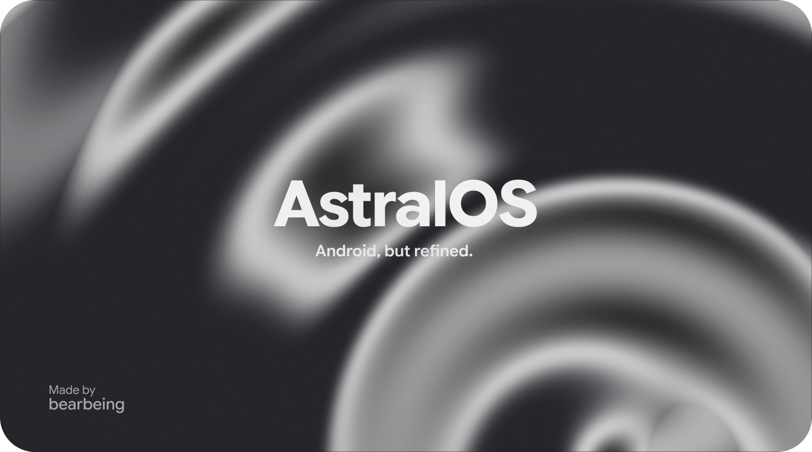

# AstralOS

**A free and open source custom ROM based on LineageOS.**

## Supported Devices

| Device                                                 | Codename   | Status   | Maintainer    |
| ------------------------------------------------------ | ---------- | -------- | ------------- |
| Xiaomi Redmi Note 9 Pro / 9 Pro Max / 9S / POCO M2 Pro | miatoll    | Official | @bearbeing |
| Samsung Galaxy S20 FE 5G / 4G (Snapdragon)             | r8q        | Official | @bearbeing |
| Samsung Galaxy S10e                                    | beyond0lte | Official | @bearbeing |
| LG V30                                                 | joan       | Official | @bearbeing |

**[Full device list](other.md)**
**[AstralOS features](features.md)**

## GSI

AstralOS is also available as a **Generic System Image (GSI)** for compatible devices.

More devices will be added over time.

**Device support is still in development and availability may change.**

## Our Channels

