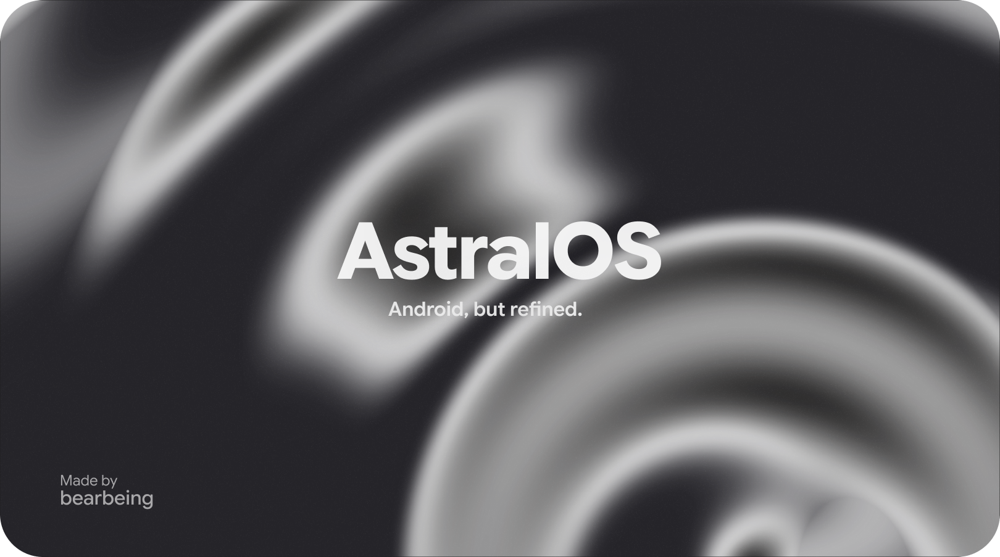

# AstralOS

A free and open-source custom ROM based on LineageOS, the future of AOSP.

AstralOS is an Android custom ROM developed by **[AstralOSProject](https://github.com/AstralOSProject)**.

This is the GitHub organization for the AstralOS Android ROM project. Find our source code, supported devices, features and development updates here.

**[Full device list](other.md)**

**[AstralOS features](features.md)**

# AstralAI

Our AI application, built to bring artificial intelligence into an easy-to-use experience.

AstralAI is powered by AstralAI NEXT, our AI model that we're developing as part of the project.

## GSI

AstralOS is also available as a *Generic System Image (GSI)** for devices.

More devices may be added over time.

Device support is still in development and availability may change.

## Our Channels

## Official Project

- **Official GitHub organization:** https://github.com/AstralOSProject

AstralOS refers here to the Android custom ROM developed by AstralOSProject. Other software projects may use names but are not necessarily affiliated with this project.

---

**AstralOS — Android, but refined.**
